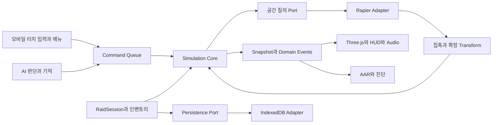

# CQB TACTICAL 3D 익스트랙션 전환 아키텍처

목표는 기존 전투 계산의 의미를 보존하면서, 싱글플레이 PvE 레이드의 조작·세계·표현을 추가하는 것이다. 새 앱의 시뮬레이션은 전투 결과를 소유하고, Rapier는 물리 접촉과 공간 질의를 제공하며, Three.js는 시뮬레이션 snapshot과 사건을 표시한다. 단층 3D 맵과 기존 2D AI 기억 모델을 먼저 연결하고, 다층 탐색과 정교한 캐릭터 애니메이션은 다음 단계로 둔다.

이 문서는 [구조 감사](structure-audit.md)를 바탕으로 한 목표 설계다. 사용자 요구에 따라 주 플랫폼은 **모바일 브라우저의 가로화면**으로 확정했다. 원본의 시스템별 소스·단일 HTML 빌드에 이어 `apps/training/`에 첫 M4A1 3D 훈련장을 추가했다. Three.js·Rapier, 독립 조준·총구 접촉과 모바일 입력은 훈련장 범위로 구현했으며, 아래 기존 계산 Core·Port·전투 adapter·RaidSession은 아직 구현하지 않았다. 현재 구조와 실행 방법은 [개발 안내](development-guide.md)와 [훈련장 안내](../apps/training/README.md)에 있다.

## 결정한 기술 범위

훈련장에는 원본 초기화 순서를 사용하는 build-time catalog adapter를 구현했다. 레지스트리 전체와 source switch 이후의 파생·의료·방호 보조 데이터를 불변 정의로 내장한다. `Inventory`가 `instanceId`·단일 owner·장착 무기·탄창의 실제 낱발 순서·약실을 소유하며, `RecoilState`가 발사 사건의 운동량과 사수 응답을 계산한다. `weapon-model`은 이 상태와 phase를 읽어 모션을 표시하고 탄약을 변경하지 않는다. UI의 탄약 선택은 탄창을 채울 낱발 스택 선택이며, 발사 탄종은 약실에서 확정한다. 실제 피해·방호·의료·AI Core 및 저장 계약은 아래의 후속 설계다.

| 영역 | 채택 방향 | 이유와 범위 |
| --- | --- | --- |
| 개발과 배포 | JS 소스 + Node 빌드, 배포는 단일 HTML | 2D 원본은 Node 조립으로 정확히 재현. 별도 3D 앱은 ES modules와 esbuild로 모델·WASM까지 내장 |
| 기존 계산 | 우선 JavaScript 형태와 수치를 보존해 추출 | 모듈화와 타입 재작성을 한 번에 진행하지 않음 |
| 3D 화면 | Three.js WebGLRenderer, PerspectiveCamera | 모바일 가로화면 WebGL2, Android Chrome·iOS Safari 실기기 우선. WebGPU는 후속 |
| FPS 입력과 조준 | 왼쪽 이동 패드·오른쪽 드래그, 카메라와 총의 제한된 독립 조준 | 몸에 부착한 카메라 느낌과 실제 총구 방향 사격. WASD·Pointer Lock은 데스크톱 디버그 보조 |
| 물리 | Rapier 3D, kinematic capsule 캐릭터 | 플레이어와 AI가 같은 이동 충돌 계약을 사용 |
| 전투 접촉 | Rapier ray 질의와 단순 collider의 분석적 entry/exit | 기존 관통·도탄 계산을 그대로 활용 |
| 경로 | 기존 A*와 방·문간 모델의 단층 투영 | 첫 맵에는 계단·복층이 없어 navmesh 도입을 보류 |
| 저장 | IndexedDB, 버전 있는 DTO와 단일 정산 transaction | stash·레이드 간 원자적 이동과 중복 정산 방지 |
| 실행 위치 | 브라우저 메인 스레드 | 1명 NPC부터 시작, 모바일에서 2~4명으로 계측 후 확장·worker 여부 결정 |

[Three.js WebGLRenderer 공식 문서](https://threejs.org/docs/pages/WebGLRenderer.html)를 화면의 기술 기준으로 사용한다. 모바일 시점은 터치 변위를 yaw·pitch로 변환한다. [PointerLockControls](https://threejs.org/docs/pages/PointerLockControls.html)는 선택적인 데스크톱 시점 도구다. Rapier의 [캐릭터 컨트롤러](https://rapier.rs/docs/user_guides/javascript/character_controller/)가 보정한 이동을 kinematic body에 적용한다. 카메라를 먼저 움직인 뒤 충돌을 검사하는 구조를 피한다.

첫 훈련장에서 Three.js `0.180.0`과 `@dimforge/rapier3d-compat` `0.21.0`의 내장 모델·WASM 초기화를 확인하고 lockfile로 고정했다. “latest” CDN에 런타임을 의존하지 않는다. WASM과 모델 준비 전에는 시작을 막고 로드 오류를 화면에 표시한다. 실제 모바일 성능·저장 검증은 후속 단계다. [Rapier JavaScript 시작 안내](https://rapier.rs/docs/user_guides/javascript/getting_started_js/)를 기준으로 한다.

## 모바일 조작과 화면 계약

화면 왼쪽 이동 패드와 오른쪽 시점 영역을 기본으로 하고 사격·ADS·재장전·자세·상호작용·치료 버튼을 배치한다. 이동 중 시점 변경과 사격이 동시에 가능해야 한다. 각 `pointerId`는 시작한 조작 영역이 소유하고 영역을 넘어도 다른 조작으로 바뀌지 않는다. UI 터치를 시점 입력으로 함께 처리하지 않는다. ADS는 기본 토글, 사격은 누르는 동안 유지하고 버튼 크기·위치·시점 감도는 설정으로 분리한다.

`pointerup`·`pointercancel`·capture 상실·회전·앱 비활성화에서 이동과 사격 held state를 해제한다. 가상 키보드나 hover 없이 필수 조작을 완주할 수 있어야 한다. 풀스크린·화면 방향 잠금은 제공되는 경우의 편의 기능이며 레이드 시작 조건이 아니다. 3D 단계에서는 세로 전환 시 안내와 일시정지를 적용하고, 가로 복귀 후 명시적인 재개 입력을 받는다. 현재 2D 원본의 회전 안내 동작은 변경하지 않았다.

HUD는 `safe-area-inset-*`와 브라우저 주소창에 따른 viewport 변화를 고려한다. CSS 화면 좌표와 렌더 해상도를 분리하고 DPR·render scale에 상한을 둔다. 처음에는 그림자·후처리를 최소화하고 실기기 프레임 시간과 발열을 측정해 품질을 정한다. 모바일 3D의 성능 수치는 아직 측정하지 않았다.

## 몸에 부착한 카메라와 독립 조준

사용자는 Bodycam을 참고한 카메라 움직임과 사격 효과를 요구했다. 목표는 카메라의 관성과 총의 독립적인 움직임, 사격의 무게감을 초기 프로토타입부터 검증하는 것이다. 해당 게임 내부 구현을 조사해 동일하다고 주장하는 설계가 아니며, 구체적인 감각은 훈련장에서 조정한다.

이동 body, 논리 weapon pose, 화면 camera rig를 분리한다. 터치가 만든 look·aim intent를 제한된 free aim 범위 안에서 총의 방향에 반영하고, 범위를 넘는 회전에서는 몸과 기본 시점이 따라온다. 화면 중앙에 총을 고정하지 않는다. 총은 회전 관성과 손의 흔들림을 가지며, 카메라는 몸통 부착 위치에서 보행 상하 이동·좌우 기울기·착지 반응을 별도로 표현한다. 손떨림·회전 지연·부착 위치·free aim 범위는 조정 가능한 설정이며 값은 아직 실측하지 않았다.

ADS에서는 총과 조준기를 카메라 앞에 들어 올리고 free aim·흔들림을 줄여 정렬한다. 단순 FOV 확대만으로 ADS를 대체하지 않는다. 조준기 정렬과 가까운 표적에서의 총구·조준선 높이 차이를 확인한다. 주 조작은 두 엄지를 기준으로 하며, 사격 버튼을 누른 상태의 드래그도 같은 pointer 소유권 안에서 조준 intent를 갱신할 수 있게 한다.

현재 훈련장은 사용자 제공 `aim_rig.html`을 참고해 입력이 총기 intent를 만들고, 총기 반응을 계산한 뒤 카메라가 추종하는 순서로 구현했다. 시점을 먼저 회전하고 총이 뒤따르던 초기 실행본을 교체했다. 일반·ADS 감도, 카메라 프리셋·추종 속도·이탈 제한·총기 반응·시야각은 별도로 조절하며, 설정 저장이 불가능한 origin에서도 세션 조작은 유지한다.

M4A1의 ADS 기준은 실제 가늠자 구멍 중심과 가늠쇠 끝이다. 정지 자세에서는 두 점의 선을 보정하고, 가늠자 뒤 7.5cm 위치에 눈을 맞춘다. 움직일 때는 뒤늦게 따라오는 견착 방향이 가늠자 위치를 정하고, 총기가 그 둘레에서 먼저 회전한다. 가늠쇠가 먼저 움직이며 보행·반동도 정렬을 잠깐 흐트러뜨리고 정지하면 다시 수렴한다. 보행에는 실제 이동 속도로 진행하는 위치·회전 주기와 진폭 회복을 적용했다. ADS에서는 표시용 카메라 위치 흔들림을 줄이고 조준기 움직임을 논리 총 자세에서 만든다. 총열축과 조준선은 별도이며 발사는 실제 총구·총열 방향을 따른다. 비조준 총기의 기본값은 크기 115%·높이 −1cm이며, 오른쪽으로 1.5cm 옮겼다. 들어 올린 자세와 카메라 거리로 몸통을 보이게 하고 원근 과장을 줄이며, 보행 상하 움직임은 25% 줄였다. ADS에서는 보정 크기·높이로 돌아온다. 모델과 모든 사격 기준점은 같은 크기·자세를 공유한다. 총기 크기·높이·움직임 강도는 메뉴에서 조절한다. 세부 구현·검증 범위는 [훈련장 안내](../apps/training/README.md)를 따른다.

명중에 영향을 주는 weapon orientation·조준 sway·물리적 반동은 simulation tick에서 갱신한다. render는 그 pose를 읽고 보간하며 발사 순간의 총구 위치·방향을 변경하지 않는다. 화면만 흔드는 camera shake와 roll은 presentation 상태이며 명중 계산에 역으로 쓰지 않는다. 렌더 생략·30/60/120fps에서 같은 tick의 발사 결과가 같아야 한다. 기존 산포·aimTimer 감소와 새 총구 회전을 모두 같은 오차로 중복 부과하지 않도록 반동·산포·조준 회복의 역할을 명시한다. 기존 계산 추출과 새 FPS 조준 모델의 추가는 각각 검증한다.

발사가 확정되면 발사 순간의 총구 pose를 기록한 하나의 shot 사건에서 무기 킥·별도 카메라 충격·총구 섬광·탄피·총성과 피격 효과를 파생한다. 현재 탄의 방향은 발사 시점에 확정하고 그 발사가 만든 반동 상태는 이후 조준과 다음 탄에 반영한다. 피격 먼지·불꽃·자국은 실제 접촉 위치·법선·재질을 따른다. 소음 사건과 의료 손상은 시뮬레이션에서 이미 확정하며 효과나 오디오의 성공 여부가 결과를 바꾸지 않는다.

몸통 카메라 부착점은 충돌 capsule과 별도로 고려한다. 낮은 엄폐에서 눈·카메라·총구의 높이가 다르다는 점을 반영하고, 카메라 벽 clipping 방지는 몸의 확정 위치를 변경하지 않는 bounded camera offset으로 처리한다. 총이 벽에 가까워지면 clearance pose와 사격 차단을 논리 상태에서 결정해 실제 총구가 벽 너머로 넘어가지 않게 한다. 시각적으로만 총을 내리고 계산상의 총구를 벽 안에 남기는 구현은 허용하지 않는다.

가벼운 렌즈 왜곡·비네트·노출 반응은 후속 품질 옵션으로 둔다. 초기에는 관성·총구 방향·반동·짧은 사격 효과를 먼저 구현한다. HUD는 왜곡하지 않고, 추후 왜곡을 켜도 조준기·접촉 표시와 실제 탄도가 일치하는지 확인한다. 모바일에서는 postprocessing 비용과 화면 흔들림을 각각 조절하며, 흔들림 감소 옵션은 카메라 연출만 줄이고 무기 반동·산포는 바꾸지 않는다.

## 단일 HTML 배포 계약

개발 중에는 시스템별 소스와 외부 패키지를 관리하고 최종 전달물은 HTML 한 파일로 만든다. 현재 `npm run build`는 JS·CSS를 내장해 원본과 동일한 HTML을 만든다. 3D 단계에서는 번들러 결과와 Rapier WASM, 필요한 모델·텍스처·오디오도 내장하고 WASM·바이너리 로더를 명시적으로 연결한다. JS를 합치는 것만으로 WASM과 에셋이 자동 내장되지는 않는다.

단일 HTML은 런타임 CDN이나 별도 asset 요청 없이 부팅·레이드 실행이 가능해야 한다. Blob URL을 사용하면 수명과 해제를 관리하고 CSP·모바일 브라우저 로딩 제약을 검증한다. 대용량 asset의 내장 크기와 초기 메모리를 계측한다. IndexedDB의 `file://` 지원과 origin 유지 여부는 브라우저별로 실기기 검증하며, 파일을 직접 열 때 영구 저장을 보장할 수 없는 환경에는 명시적 save export/import를 검토한다. 파일 배포와 HTTP 배포의 저장 동작을 동일하다고 가정하지 않는다.

## 계층과 의존 방향



Core는 Three.js·Rapier·DOM을 import하지 않는다. composition root가 adapter를 만들어 port에 주입한다. Three.js mesh, collider handle, DOM node를 actor나 item 데이터에 넣지 않는다. Rapier handle은 adapter의 actorId·bodyPartId·surfaceId 매핑 테이블에서만 관리한다.

물리 adapter가 가진 body transform을 이동 결과의 정본으로 삼고, simulation은 tick 경계에서 확정 transform을 수신한다. render는 직전과 현재 snapshot을 보간한다. render transform은 다음 tick의 물리·피격·AI 입력으로 역류하지 않는다.

기존 2D 본편은 원본 그대로 유지한다. 새 모듈을 본편에 바로 주입하는 변경은 이번 프로토타입의 필수 조건이 아니다. 공용 계산 추출 완료 후, 별도 2D 진단 뷰나 본편의 opt-in adapter를 추가할 수 있다.

## 계산 분리와 3D 단계의 제안 디렉터리

현재의 `src/data`, `combat`, `medical`, `ai`, `presentation` 등은 같은 전역 스코프에서 조립되는 원본 소스 조각이다. 파일 이름만으로 아래의 독립 Core가 완성된 것으로 취급하지 않는다. 다음 단계에서 실제 의존 경계를 추출하고, 별도 3D 엔트리와 adapter를 추가한다. 새 경계도 우선 JavaScript로 작성하며 필요하면 JSDoc 또는 TypeScript를 도입한다.

```text
CQB_Tactical.html                 # 원본 유지
reference/                        # 원본 유지
docs/                             # 이번 감사와 계획
apps/extraction/                  # 향후 신규 앱
  src/bootstrap/                  # 조립과 로딩
  src/core/data/                  # registry, builder, validation
  src/core/combat/                # weapons, ballistics, armor, impact
  src/core/medical/               # wounds, physiology, treatment
  src/core/ai/                    # perception memory, utility, intents
  src/core/raid/                  # raid lifecycle, inventory, settlement
  src/core/runtime/               # time, rng, command/event, state
  src/ports/                      # plain DTO 기반 계약
  src/adapters/legacy/            # px와 기존 필드 호환
  src/adapters/rapier/            # movement, LOS, ray, sensors
  src/adapters/navigation/        # single-floor projection
  src/presentation/three/         # scene, camera, meshes, FX
  src/presentation/hud/           # vitals, ammo, loot, menus
  src/presentation/audio/         # 사건의 소리 표현
  src/persistence/                # IndexedDB, migration
  src/content/                    # raid map, spawn, loot definitions
  tests/                         # parity, contracts, raid flows
```

초기에는 actor를 큰 plain object로 보존해도 된다. 완전한 ECS나 외부 상태 관리 프레임워크는 첫 레이드의 선행 조건이 아니다. 의존 방향과 상태 소유권을 먼저 확정한다.

## 상태 소유권

| 상태 | 소유자 | 다른 계층의 접근 |
| --- | --- | --- |
| Actor transform·충돌 shape | Rapier adapter, simulation에 tick 결과 반영 | presentation은 snapshot만 읽음 |
| 의료·상처·내구도·탄약·행동 타이머 | Simulation Core | UI와 AI는 읽고 command로 변경 요청 |
| AI 기억·신뢰도·선택 행동 | 각 NPC의 AI state | 실제 기하와 구분. 디버그 snapshot만 외부 공개 |
| 레이드 상태·시간 제한·탈출 카운트 | RaidSession | UI는 결과 표시, trigger는 후보 사건 전달 |
| stash와 레이드 정산 | ProfileStore와 SettlementService | IndexedDB transaction으로 commit |
| Look·aim intent | input controller | 화면 효과가 없는 입력 기준으로 command 전달 |
| Weapon pose·총구 방향·사격 반동·조준 sway | Simulation / WeaponController | 발사 방향의 정본. presentation은 snapshot과 shot 사건으로 표시 |
| 카메라 부착·보행 움직임·충격·화면 효과·메뉴 선택 | presentation | 입력 기준과 분리. 화면 흔들림이 탄도 결과로 역류하지 않음 |
| collider handle·mesh 참조 | 각 adapter | actorId와 surfaceId로만 연결 |

기존 `medical`과 상처를 정본으로 두고, legacy hp·pain·combatState는 호환 projection으로 유지한다. UI에서 hp와 medical을 각각 수정하지 않는다. 의식·사망·행동 가능 여부는 기존 의료 요약을 따른다.

단독 플레이어에게는 PlayerController만 명령을 만든다. NPC에게는 AIController만 명령을 만든다. 공통 생리·반동·탄약·치료 tick은 동일하다. NPC를 기존 `enemy` 의미에 매핑하되, 새 `controllerKind`와 faction을 구분해 “friend이면 플레이어”라는 암묵적 계약을 만들지 않는다.

## 시간과 tick

초기 simulation·Rapier timestep은 1/60초로 제안한다. AI의 기존 재평가·스캔 간격은 우선 보존하고, NPC별 실행 시점을 분산한다. 수치는 기준 장비·NPC 수에서 계측 후 조정한다.

한 tick의 순서는 다음과 같다.

1. 입력 command 검증, 이전 사건에 따른 상태 전이, 문 상태·collider와 geometry revision 확정.
2. 공통 action timer, 기존 순서의 medical·치료 진행, 행동 가능 상태 확정.
3. 최신 확정 세계에서 AI 감각 갱신과 기억 갱신, 주기 도달 NPC의 utility 판단.
4. 플레이어·AI movement intent를 Rapier 컨트롤러에 전달하고 world를 step.
5. actor transform과 신체 hitbox를 동기화하고 공간 질의 자료가 최신 상태인지 보장.
6. 유효한 발사·재장전·상호작용을 확정한다. 탄도→방호→상처→급성 반응을 즉시 적용하고 같은 tick의 후속 행동을 재검증한다.
7. 소음·감각 볼륨·위협 기억 갱신. 탈출 sensor는 broadphase 후보로만 사용하고 실제 actor 조건을 검사한다.
8. 사망·실패를 먼저 확인한 뒤 탈출을 확인하고 사건과 snapshot을 발행한다.

medical의 지속 진행은 각 tick 한 번이며 신규 상처의 지속 출혈은 다음 tick에서 반영된다. 피격 즉시 출혈·급성 반응은 기존 damage 경로가 소유한다. shot queue·치료·knockdown·약물 timer별 소유권을 표로 관리해 이중 감소를 방지한다.

RAF는 accumulator를 채우고 일정 step만 실행한다. 한 프레임의 catch-up 예산을 두며 초과한 시간은 게임 시계에서도 진행하지 않고 계측한다. 비활성 탭·앱 전환, 메뉴의 Pause, 세로 전환 시 싱글플레이 전체를 일시정지하고 accumulator와 held input을 비운다. 데스크톱 보조 입력에서는 Pointer Lock 해제도 같은 정책을 적용한다. 소요 시간·의료·탈출 countdown은 같은 simulation clock을 사용한다. 모바일 렌더 30fps와 simulation 60Hz는 분리한다.

기존 가변 dt와 고정 dt의 결과가 같다고 미리 가정하지 않는다. 계산 추출 비교는 같은 seed와 같은 dt 시퀀스로 먼저 하고, 고정 tick 전환은 별도 검증한다. render 30/60/120fps·완전 생략 조건에서도 같은 simulation tick 수의 결과가 같아야 한다.

## 공간 좌표와 단위

새 정본은 m, s, m/s, rad, g 또는 명시된 질량 단위다. 총기·탄약의 기존 추상 damage·penetration 수치는 그대로 유지하며 SI 에너지나 실제 방호 등급으로 재해석하지 않는다.

단층 이식은 `X = legacyX / 32`, `Z = legacyY / 32`, `Y = 실제 높이`로 한다. legacy facing 방향 벡터는 `(cos(facing), 0, sin(facing))`로 변환한다. Three.js 카메라의 기본 forward와 별도 변환하며 yaw·좌우 부호는 front/rear/left/right fixture로 고정한다. 화면 Y축과 anatomical 좌우를 같다고 가정하지 않는다.

기존 px 계약이 필요한 함수는 legacy adapter에서만 m→px를 변환한다. 예를 들어 장벽 pathLengthM을 기존 entry/exit 단위로 바꿀 때 길이만 ×32로 전달한다. 새 모듈로 정리한 이후에는 pathLengthM을 직접 받는다.

actor의 기준점은 발 위치로 정의하고, capsule 중심·눈 위치·총구·신체 구역을 별도 오프셋으로 둔다. 맵의 바닥 footprint, wallHeight, coverHeight, thickness, door hinge, trigger AABB를 정본 정의에서 만든다. mesh와 collider를 서로 독립적으로 수동 저작하지 않는다.

## 공간 질의 Port

| Port | 입력 | 결과와 계약 |
| --- | --- | --- |
| Movement | actorId, 현재 pose, 요구 displacement, stance | 실제 displacement, grounded, 접촉 surfaceId. 실제 세계 기준 |
| BallisticQuery | originM, unit direction, maxDistanceM, query mask, 제외 조건 | 가장 가까운 Contact, surfaceId 또는 actorId·bodyPartId, point·normal·distanceM |
| SurfaceTraversal | surfaceId, entry point, direction | exit point, 통과 길이, 재질·관통 가능 여부. collider와 정본 기하 기준 |
| Visibility | 관측자 eyes, 표적 body sample, FOV·감각 상태 | visible/confidence/reason. 수직 LOS와 낮은 엄폐 반영 |
| Navigation | 단층 start/goal, actor 크기, 기억된 장애물, door 상태 지식 | plan path와 revision. 기억된 세계 기준 |
| CoverValidation | 기억 후보, 자세, 위협 방향 | 이동 가능성·피격부위 노출. 물리 검증은 실제 세계 기준 |
| Interaction | actorId, view ray, 거리 한도, targetId | 허용 대상·사거리·LOS 검증. 단순 UI 선택을 승인하지 않음 |

Rapier의 [scene queries](https://rapier.rs/docs/user_guides/javascript/scene_queries/)에서 ray 결과와 normal을 얻고 query filter로 자기 자신·운동 capsule·trigger를 분리한다. direction을 정규화해야 ray의 timeOfImpact를 거리 m로 해석할 수 있다. 여러 collider의 반환 순서를 신뢰하지 않고 거리로 결정한다.

이동 capsule은 총알의 신체 부위를 판정하지 않는다. 별도의 query 전용 머리·목·흉부·복부·좌우 팔·좌우 다리 shape를 사용한다. 이동 질의는 그 shape를 제외하고, 탄도 질의는 운동 capsule을 제외한다. 방호구의 별도 collider에서 방호를 재계산하지 않고, 접촉 주소를 기존 coverage resolver에 전달한다.

첫 맵의 wall·cover·door는 cuboid 중심으로 제한한다. 관통 exit는 해당 cuboid의 local ray 구간 계산으로 구한다. 단순 ray API 호출 한 번으로 두께가 얻어진다고 가정하지 않는다. 회전 cuboid는 ray를 local space로 옮겨 계산한다. 일반 triangle mesh의 두께 추정은 후속이며 첫 레이드의 필수 요소가 아니다.

## FPS 발사와 기존 탄도 연결

플레이어는 표적 객체 없이 방향으로 발사할 수 있어야 한다. `fireWeapon(shooter, target)`를 FPS 입력의 public API로 사용하지 않는다. 무기 상태·사격 모드·ammo 소비·발사 간격·재장전을 ShotCommand와 WeaponSystem으로 분리한다.

플레이어의 발사 origin과 기본 방향은 발사 tick의 논리 weapon pose에서 얻은 실제 총구 위치·총신 방향이다. free aim과 관성 중에는 총신이 화면 중앙과 다를 수 있으며, 카메라 중앙 ray로 강제로 수렴시키지 않는다. 카메라 ray는 시점 기준의 상호작용 후보와 선택적 진단에 사용하고 발사 방향을 덮어쓰지 않는다. 가까운 벽에서는 총구까지의 clearance와 전방 차폐를 확인한다. 카메라가 모퉁이 밖을 보더라도 벽 안이나 벽 너머 총구에서 발사하지 않는다. 자기 collider 제외 규칙을 명시한다.

플레이어 사격은 입력 aim·ADS·반동·움직임·의료 상태로 실제 ray 방향을 만든다. NPC는 기존 aim quality와 spread를 재사용한다. 3D에서 실제 ray가 맞힌 뒤 명중 확률로 다시 miss를 뽑는 이중 판정은 하지 않는다. NPC의 조준 능력은 ray 방향의 오차로 반영한다.

첫 레이드의 탄은 즉시 segmented ray로 판정한다. 기존 본편도 ray 기반이며 bullet travel time·낙하를 새로 넣는 변경은 계산 보존과 분리한다. 고속 총알을 매 프레임 움직이는 작은 rigid body로 만들지 않는다. 추후 비행 탄도를 넣으면 고정 step 간 swept segment와 동일 impact 계약을 사용한다.

발사 처리 순서는 다음과 같다.

1. 발사 조건 검증과 탄약 한 번 소비, `shotId` 부여, 소음 사건 발행.
2. 총구 origin과 실제 방향으로 가장 가까운 접촉 조회.
3. 장벽이면 재질·pathLength·normal을 기존 저항·관통·도탄 함수에 전달.
4. 잔여 penetration·damage·velocity·stability와 누적 거리를 유지하며 다음 segment 진행.
5. 신체면 3D 접촉 주소를 확정해 방호→인체→상처→급성 반응→의료 사건을 처리.
6. continuation은 감쇠된 잔여 위협과 실제 exit에서 시작한다. 이벤트·AAR·FX는 같은 segment 결과를 읽는다.

기존 `RAY_MAX_SEGMENTS = 16`, `MAX_CONTINUATION_DEPTH = 2`를 초기 예산으로 보존하고 최대 거리·최소 에너지·반복 surface 조건도 제한한다. exit epsilon과 같은 표면 재접촉 방지를 두되, surface를 무조건 영구 제외해 도탄 후 합법적인 재접촉을 놓치지 않는다. 첫 단계에서는 기존 excluded 정책과 새 정책의 차이를 별도 fixture로 검증한다.

거리 감쇠는 Core Ballistics 한 곳에서 소유하도록 최종 정리한다. 이식 중에는 기존 resolveImpact의 감쇠 위치를 유지하며 adapter가 미리 같은 retention을 적용하지 않는다. 장벽 후 손실과 거리 손실의 순서를 기존 결과와 대조한 뒤 명시적인 ImpactKinematics 계약으로 전환한다.

## 3D 접촉 주소와 방호 의료 경계

Contact를 actor의 local pose에 투영해 anatomical side·region·part·zone·subZone을 결정한다. coarse proxy로 표현 가능한 세부 구역만 주소로 확정하고 실제 관측 정밀도보다 상세한 해부학 좌표를 주장하지 않는다. 머리 collider도 face와 skull의 진입 면·높이 규칙을 별도 정의한다.

| 입력 또는 사건 | 필수 정보 | 소유 계약 |
| --- | --- | --- |
| ShotContext | shotId, sourceActorId, weaponId, ammoId, muzzle/impact velocity, 누적 distanceM, 잔여 위협 | 탄도 계층 |
| ImpactContact | targetActorId, 실제 incoming direction, point·normal, bodyPartId, impactAddress, stance | 3D 접촉 번역 계층 |
| ArmorResolution | protection layer, ownerId, slotKey, stopped/penetrated, backer, 국부손상, residual threat | 기존 방호 규칙 |
| DamageEvent | sourceType, hitPart·isLeft, 동일 주소, 조직손상·둔상·bleed·pain, 탄약 profile | 인체·의료 경계 |
| WoundCreated와 ActorStateChanged | woundId, 피해 주소, 급성 반응·의식·행동 상태 | 의료 계층 |
| ShotResolved와 ArmorDamaged | segment 결과와 동일 shotId·ownerId | AAR·화면 소비용 |

초기 bridge는 기존 forced 훅으로 계약 실험을 할 수 있다. 다만 최종 새 진입점은 location 추첨을 실행하지 않으며, 동일 address가 bodyTrajectory·wound·armorLog에 도달한다. bodyTrajectory의 기존 후보·잔여 위협 모델을 계산 모델로 보존하고, 실제 3D 장기 mesh 관통 모델로 간주하지 않는다.

방호와 내구도는 기존 layer selection을 한 번만 실행한다. headshot 추가 damage multiplier, 별도 FPS hp 체계, 방호구 collider의 두 번째 armor 판정을 추가하지 않는다. UI용 hp도 medical 요약에서 파생한다. stopped/absorbed의 둔상과 관통상 출혈 금지 계약을 보존한다.

## 의료 행동과 FPS 조작

피격에 따른 movement·aim·shoot 제한은 플레이어와 NPC에 같은 규칙으로 적용한다. 기존 canMove·canShoot·mobility·aimPerformance·급성 block을 Controller가 소비한다. 의식 있는 downed는 낮은 시점과 제한 조작으로 표현하며 기존 규칙이 허용하는 사격·치료를 유지한다.

첫 레이드의 자가치료는 부위 선택→가능한 처치 표시→수 초간 수행→완료 효과와 자원 소비로 구성한다. 자원 예약, actionId, 완료·취소를 Core가 관리하고 UI는 진행률을 보여 준다. 취소 시 예약을 반환하며 완료 시 한 번만 소비한다. 피격·사망·손 사용 불가 시 기존 허용 규칙을 적용한다.

치료 메뉴 자체는 레이드를 멈추지 않는다. 터치 Pause 메뉴·앱 비활성화·세로 전환은 일시정지 정책을 따른다. pause와 treatment UI를 별도 상태로 관리한다. 출혈을 즉시 hp 회복으로 치환하지 않으며, 치료 결과는 기존 상처·혈역학 경로에 반영한다.

## AI 이식

첫 NPC 행동은 기존 utility 후보 중 감각·전투·엄폐·문 통과를 연결해 검증한다. “patrol” 같은 이름이 현재 코드에 존재한다고 가정하지 않는다. 조용한 레이드의 이동 동기가 필요하면 별도의 authored patrol objective를 낮은 우선순위로 제공하고, 기존 위험 반응을 덮지 않도록 후속 변경으로 검증한다.

AI memory는 기존 2D 면·문턱·방 지식을 XZ 평면에 보존한다. 실제 시야는 eye height와 head·torso 등 표적 sample을 ray로 검사한다. 낮은 cover 뒤 서 있는 actor와 crouch actor가 서로 다르게 관측되어야 한다. 감각은 실제 세계에서 관측만 생성하고, utility context가 숨은 플레이어 위치나 모든 루트 객체를 직접 읽지 않게 한다.

A*는 믿는 지형에서 계획할 수 있고, Rapier는 실제 벽에서 이동을 막는다. 충돌 결과를 contact observation으로 기억에 넣고 재계획·실패 쿨다운을 유지한다. 이는 기존의 잘못된 믿음이 교정되는 핵심 계약이다. 다층 맵을 추가할 때 region·floorId·수직 연결과 navmesh 도입 여부를 다시 설계한다.

문은 단층 portal 의미를 유지한다. 첫 구현에서는 개방 action 동안 닫힘 mesh·collider를 같이 유지하고 완료 순간 둘을 같은 tick에 열린 pose로 변경한다. decorative swing으로 물리와 보이는 틈이 어긋나지 않게 한다. 연속 회전 문은 후속 단계에서 kinematic shape·기억·경로 revision과 함께 추가한다.

소음의 “AI가 들었음”은 simulation 사건이고 Three.js positional audio의 “사용자가 들었음”은 표현이다. 오디오 재생 여부가 AI 판단을 바꾸지 않는다. 연막·먼지도 simulation의 density·occlusion을 정본으로 만들고 shader의 alpha를 감각 입력으로 사용하지 않는다.

## 레이드와 저장 계약

레이드 상태는 `Preparing → Loading → Active → Extracting → Finished → Settled`로 제안한다. Extracting은 Active의 조건부 하위 상태로 취급하며 구역 이탈 시 Active로 돌아간다. 사망·지속 의식상실 정책·시간 초과는 Failed 결과로 Finished에 도달한다.

첫 프로토타입은 레이드 5~10분을 목표로 하되 제한 시간은 10분, 탈출 대기는 5초로 둔다. 기본 탈출 조건은 alive·conscious·구역 내부이며 의식 있는 downed도 조건을 충족하면 탈출할 수 있다. 전리품이나 적 전멸은 필수 조건이 아니다. 이 수치는 게임 규칙 제안이며 기존 코드 수치가 아니다.

탈출은 sensor 이벤트만으로 완료하지 않는다. 매 tick playerId, 위치, 생존·의식, 현재 레이드 상태를 확인한다. 구역 이탈이나 의식상실은 countdown을 초기화한다. 피격만으로는 초기화하지 않고 피격으로 조건이 깨질 때 초기화한다. 마지막 tick에 사망과 탈출이 겹치면 실패가 우선한다.

싱글플레이 프로토타입은 지속 의식상실 10초를 실패 유예로 제안한다. 이는 사망 판정이 아니라 도움을 받을 수 없는 레이드 종료 정책이다. 유예 중 회복하면 Active로 복귀한다. 의료 코어의 unconscious·dead 의미를 변경하지 않는다.

일반 item instance는 instanceId·definitionId·수량·무게·상태를 가지며, 무기는 기존 weapon build와 ammo 상태, armor는 owner·slot·local damage, 의료품은 기존 자원을 참조한다. 기존 throwables·magAmmo가 일반 루팅 시스템을 대신하지 않으므로 새 inventory가 소유한다. 사용자 요청으로 훈련장에 격자 용량을 먼저 구현했다. 인스턴스는 소유자 하나와 공간 컨테이너의 cell 좌표를 가지며 탄약 1×1/최대 60발, 탄창 1×2, 수납 총 4×2를 검사한다. 기존 탄창과 취소 시 새 탄창의 공간, 반환할 약실·혼합 탄약 스택을 동작 전에 예약한다. 장착 무기의 탄창·약실은 중첩 상태로 유지하며 루트 소유자로 실제 휴대 탄약을 계산한다. 중량 제한은 아직 연결하지 않았다.

현재 상자는 거리·LOS를 확인한 뒤에만 접근 권한을 열고, 닫을 때 외부 탄약 삽입의 남은 작업을 취소한다. 좌측 가방/우측 상자의 선택·드래그·목적지 클릭은 동일한 아이템 명령을 사용한다. UI는 소유권을 직접 바꾸지 않고 Inventory의 공간·스택·진행 중 동작 검사에 맡긴다. 향후 사망 NPC 컨테이너·상처/처치 자원·stash 정산도 이 소유권 계약에 연결한다.

레이드 시작 시 ProfileStore transaction이 장비를 stash에서 activeRaid escrow로 이동하고 raidId·seed·profileRevision을 기록한다. successful extraction은 생존 장비·남은 탄약·의료품·전리품과 변경된 내구도를 stash로 이동한다. 실패는 escrow의 투입 장비와 전리품을 소실 처리한다. 보험·보안 컨테이너는 첫 범위에 없다.

정산은 raidId를 고유 키로 하여 result와 stash 변경, escrow 해제를 한 IndexedDB transaction에 commit한다. 이미 Settled인 raidId에는 다시 보상하지 않는다. 저장 실패 시 결과 화면과 pending settlement를 유지하고 재시도하며, 새 레이드 시작은 정산 완료 뒤에 허용한다.

첫 버전은 mid-raid 저장·재개를 제공하지 않는다. 브라우저를 닫아 남은 activeRaid는 다음 로드에서 abandoned 실패로 한 번 정산한다. 이를 시작 화면에 짧게 명시한다. 앱 종료·새로고침으로 원래 stash가 복구되어 장비가 중복되지 않게 한다. 별도 새 IndexedDB 이름과 schemaVersion을 사용해 2D 원본에 저장 영향을 주지 않는다.

## 검증과 관측

기존 계산 보존과 신규 게임 완주를 별도로 검증한다.

- 계산 동일성: 동일 입력·seed·dt 시퀀스에서 장비 preset, 방호 결과, 내구도, 상처, medical 요약을 비교한다. float 허용 오차는 필드별로 사전 정의한다.
- 3D 계약: 좌우·입사방위, 낮은 cover, 관통 exit, 총구 차폐, 도탄 continuation, 다른 actor에게 도달하는 잔여 위협을 fixture로 검증한다.
- 경계 독립성: Core의 DOM·Three.js·Rapier import 금지, headless 실행, render 생략 시 결과 동일성을 확인한다.
- 완주: 진입→무표적 사격→NPC 교전→자가치료→루팅→탈출·실패→stash 정산을 browser flow로 확인한다.
- 관측: tick ms, 감각 ray 수, path 요청, 반복 충돌·정체, RNG seed, geometry revision, shotId·woundId·raidId를 진단한다. 게임 HUD에는 사용자의 결정에 필요한 상태만 표시한다.

RNG는 combat·AI·loot·FX 스트림을 분리한다. 초기 parity 단계에서는 기존 호출 순서를 유지하는 compatibility stream을 두고, 스트림 분리 자체는 별도 변경으로 평가한다. 새 FPS의 부위 추첨 제거와 AI 일정 변경은 기존 전투 전체 replay의 bitwise 동일성을 깨뜨릴 수 있으므로 계산 fixture와 게임 시나리오 지표를 구분한다. Rapier WASM의 결정성은 동일 초기값·생성 순서·버전에 대한 보장이며, JavaScript 삼각함수와 게임 로직 전체의 기기 간 동일성을 자동 보장하지 않는다. 이 범위는 [Rapier 결정성 문서](https://rapier.rs/docs/user_guides/javascript/determinism/)를 따른다.

## 보류한 설계

복층 맵·navmesh, multiplayer·서버 권위, worker 분리, bullet 비행시간·중력, 복잡한 연속 회전 문, ragdoll·full body IK, 실제 장기 mesh, 수류탄·섬광·연막, 보험·상점·제작·퀘스트·은신처는 첫 레이드 이후로 둔다. 각 추가는 기존 계산 변경과 구분해 독립 검증한다.

개발 순서와 완료 기준: [첫 레이드 프로토타입 개발 계획](raid-prototype-plan.md).
