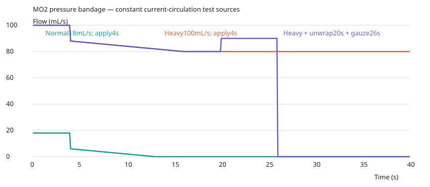
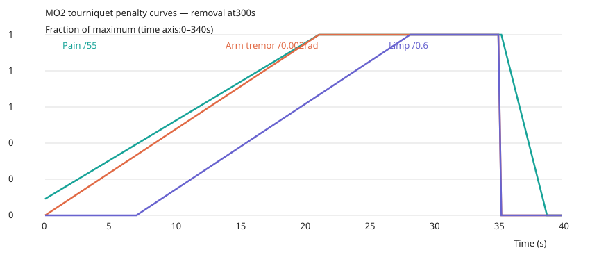

# MO2 — 지혈·회복 조건·단일 처치 정책

`feature/medical-overhaul`, 기준 `01eb585`. [사용자 지시서](mo2-instructions.md)를 적용한 **의료 개편의 중간 단계**다. main에 병합하거나 전체 개편 완료판으로 배포하지 않는다. [대장](mo2-ledger.json), [옛 값 처분표](mo2-mode-disposition.md), [수치 원자료](mo2-numerical-results.json)를 함께 본다.

## 실제 동작

내 의료품을 선택하고 의료탭 상처 하나를 누른다. 지혈대는 사지 부위를 누른다. 시작에 물품을 예약하고 완료할 때 자원과 효과를 동시에 적용한다. 현대 지혈품은 취소 시 자원·지혈 변화가 없고 다시 사용하면 고정 시간을 처음부터 쓴다. 의료 기록을 닫아도 다른 행동의 예약을 풀지 않는다. 물품·부모 파우치 이동을 예약으로 막으며 완료 직전 대상·잔량·소유권을 다시 확인한다.

| 제품 | 고정 시간 | 자원 | 범위 |
|---|---:|---:|---|
| 압박붕대 | 4초 | 2회, 상처당 1회 | 열린 겉 출혈만 |
| 지혈거즈 | 6초 | 내구도100, 효율1 | 머리 제외, 겉·사지 내부 |
| 지혈 주입기 | 5초 | 내구도160, 효율1.2 | 모든 부위, 겉·사지 내부·체강 |
| 범용 지혈 폼 | 7초 | 내구도300, 효율1.8 | 주입기와 같음 |
| CAT | 장착5초·제거2초 | 사지당 1개, 회수 가능 | 해당 사지 전 출혈 일시 억제 |

범위·붕대 2회·상처별 진행·회복 조건은 **사용자 설계값**이다. 시간·내구도·효율·각 계수는 **튜닝/게임 허용**이며 실제 의료품의 임상 성능을 뜻하지 않는다. 옛 부상·통증·한 손 시간 배율은 쓰지 않는다. 의식 소실·심정지·사망·양팔 분쇄/절단은 기존 사용 불가 조건으로 남긴다. 배낭 접근2초는 손 작업 시간과 별도로 한 번 더한다.

시작 플레이어와 적은 주입기 1개를 **벨트 1번 1×1 파우치**에 가진다. 기존 IFAK 3×3 구성은 그대로다. 장비 시스템을 쓰지 않는 축소 시험 인벤토리는 가방, 만원이면 기존 의료 파우치의 빈칸을 쓴다. 폼은 기존 복부 키트에 남긴다. 주입기 150×35×35mm/60g/격자1×1은 제원을 확인하지 못해 **튜닝**으로 표시했다. 브랜드 없는 가상 제품이다. 제조사 페이지는 다른 P30 제품으로 리디렉트됐고 요청한 구형 제품·판매처 페이지는404여서 그 값을 전용하지 않았다. 기존 제품의 무게·크기 출처는 유지한다.

## 출혈 등급과 붕대

현재 순환 상태의 원래 유량을 공유 혈관의 손상별 면적 비율로 **한 번만 배분**해 상처의 처치 전 Q0를 얻는다. 같은 순환 예산을 처치 전후에 유지해 다른 상처를 치료했다고 미처치 상처의 유량이 늘거나 붕대의 차단량이 한계를 넘지 않게 한다. 이후 실제 치료 계수를 적용하고 기존 혈액 장부로 보낸다. 체강/사지/겉 유출은 따로 유지한다.

**과다출혈 = Q0 > 20mL/s**. 일반/과다 경계와 붕대 한계는 동일한 상수다. 실제 상태는 `멎음/흐름/샘`으로 별도 표시한다. 지혈대 때문에 실제 흐름이0이어도 원래 상처가 치료된 것으로 취급하지 않는다. 부분 거즈·붕대 한계 초과·CAT만 적용한 상처는 노란색 **처치 미완료**로 표시하고, 거즈류의 지혈 진행률도 함께 보여준다. 행동 완료와 상처 처치 완료를 구분한다.

기존 S0 240조건+단일28경로의 258상처에서, 출혈이 있고 심정지가 아닌 234상처를 선택했다. 모세혈관·정맥과 주요 혈관을 분리하는 용도다. 주요 혈관 여부는 기존 `majorNamed`를 읽으며 새 손상 종류를 만들지 않는다.

| 그룹 | 수 | 최소 | 25% | 중앙 | 75% | 90% | 최대 | 선택한 분류 |
|---|---:|---:|---:|---:|---:|---:|---:|---|
| 주요 혈관 연결 | 47 | 10.286 | 47.498 | 83.646 | 88.945 | 88.945 | 88.945 | 45/47 과다(95.74%) |
| 나머지 | 187 | 0.393 | 2.904 | 10.238 | 14.382 | 26.431 | 42.941 | 163/187 일반(87.17%) |

단위mL/s. 15는 나머지 그룹 일반 비율77.0%, 30은 주요 그룹 과다 비율89.4%여서20을 시작 튜닝으로 골랐다. 이름 붙은 혈관의 작은 상처까지 모두 과다로 강제하지 않는다. 원시 분포는 [개편 전 조사](mo2-before-survey.json), 후보 비교는 수치 대장에 있다. 같은 상처에서 순환 Q0가30→12→45로 변하면 과다→일반→과다가 되고, 완성 붕대의 실제 유량은10→0→25가 된다.

붕대는 완료 즉시 한계의60%(12mL/s)를 차단하고12초 동안20mL/s까지 선형으로 증가한다. 상처당 한계라 중복 감기를 거부한다. 겉 성분만 줄이고 내부 성분은 남긴다. 거즈류 완료 상처를 감싸면 움직임 위험을 제거한다.

붕대를 감은 상처에는 거즈류를 쓸 수 없다. 상처 행의 **붕대 풀기·2초**로 제거한다. 사용 횟수는 돌아오지 않고, 외부 잔여 차단은 Q/2=10mL/s다. Q0=100에서 감은 뒤80, 푼 뒤90이 된다. 지시서의 Q=40 예시60→80과 같은 식이다. 외부 유량보다 많이 차단해 내부 출혈까지 상쇄하지 않는다. 거즈류 완료 시 이 잔여 상태를 없애고 지혈대 중에는 억제한다.



위 그래프는 현재 순환 Q0를18/100으로 고정한 검증원이다. 4초에 붕대 적용,16초에 최대 차단,20초에 제거,26초에 거즈 완료를 표시했다. 실제 순환 변화와 자연지혈은 게임의 기존 식을 따른다.

## 거즈류 필요량과 움직임

원래 혈관 개구 면적×3을 작업점으로 바꾸고 성분당 최소2점을 둔다. 공유 혈관의 lesion별 원래 면적을 쓰며 최초 사용 시 상처에 고정한다. 외부/사지 내부는 확인된 원래 개구부(관통85/15, 단일 입구40/60)로 나눈다. 현재 구획 충만도·저혈압·유량·HP를 비용에 쓰지 않는다. 제품 범위에 해당하는 남은 작업만 소비하고, 부족하면 그 비율만 제어한다. 다음 제품은 같은 진행에서 이어간다.

실질 장기 혈류원은 원래 혈관 개구 면적이 없다. 해당 위치의 **원래 상처 통로 단면 반경**으로 원면적을 구한 뒤5%를 등가 미세혈관 개구로 추정한다(**튜닝**, 실제 혈관 측정값 아님). 원래 폭도 없으면 탄두 반경을 쓴다. 조직 손상 체적·장기 severity를 필요량으로 바꾸지 않는다. 독립 ooze는 원래 탄두 단면적의5%×확인된 개구부 수, 몸통 혼합 ooze의 내부/외부 비용은 원래 유출 경로 유무에 따라1/2로 나눈다(튜닝). 이 추정의 한계는 남아 있다.

| 대표 상처,7N6 | 총 작업점 | 거즈1개로 완료 | 주입기1개로 완료 | 폼1개로 완료 |
|---|---:|---:|---:|---:|
| 대퇴동맥 경로/왼다리 | 167.59 | 0건(부분 처치) | 1건 | 3건 |
| 폐 경로/가슴 | 21.84 | 체강 범위 제외 | 8건 | 24건 |
| 간 중심 경로/복부 | 31.46 | 체강 범위 제외 | 6건 | 17건 |
| 간 후측면 경로/복부 | 267.99 | 체강 범위 제외 | 0건(부분 처치) | 2건 |

독립적인 같은 상처를 반복 치료할 때의 내림 정수다. 전체 사격이 여러 부위를 지나면 각 상처는 별도 비용이며 원자료의 부위별 표를 본다. 거즈의 겉 성분만 싸다고 체강까지 완료했다고 계산하지 않는다. 제품 하나로 모든 중상을 치료할 수 있다는 보장은 없다.

완료된 거즈류를 붕대로 마무리하지 않으면 결정론 LCG를 사용한다. 걷기: 샘0.04/s·터짐0.004/s, 달리기: 터짐0.12/s. 틱 확률은 `1-exp(-합계위험률×dt)`다. 샘은 최대0.3mL/s로8초, 터짐은 작업 진행을55%로 되돌려 다시 처치가 필요하다. 정지·웅크림·마무리 붕대·지혈대 중에는 이벤트와 난수 소비가 없다.

| 500시드,각30초 | 샘 경험 | 터짐 경험 |
|---|---:|---:|
| 정지·웅크림 | 0 | 0 |
| 걷기 | 330/500(66.0%) | 57/500(11.4%) |
| 달리기 | 0 | 490/500(98.0%) |
| 붕대 마무리 후 걷기·달리기 | 0 | 0 |

같은 시드 재실행 결과가 동일하다. 첫 터짐 이후에는 재처치 전까지 추가 이벤트 대상에서 제외한다. 30초 누적 사건 비율과 초당 위험률은 다르다.

## 지혈대와 HP

CAT는 사지당 하나, 완료 시 그 사지의 모든 출혈을0으로 만든다. 새 피격의 직접 피해는 보존하고 새 출혈도 억제한다. 같은 상처 기록에 다른 부위의 체강 출혈원이 연결돼 있어도 CAT는 그 체강 유출을 막지 않는다. 위치 선택·복수 지혈대·느슨한 지혈대·즉시 기능0·강제 쓰러짐을 제거했다. 제거 전과 후에 회수할 공간을 확인하고, 없으면 효과·소유권을 유지한다.

착용 통증5→55/180초, 제거 후30초 감소, 팔 떨림 최대0.002rad, 다리 절뚝임60초 시작·240초에최대0.6/이동배율최소0.65는 **튜닝**이다. 기존 D1 통증/떨림/걸음 충격 경로에 연결한다. 다리 기능 플래그나 의식/쓰러짐 기준을 바꾸지 않는다. 허혈·괴사·구획증후군은 추가하지 않았다.



회복은 해당 부위의 모든 상처가 완료되고 CAT가 없을 때만 시작한다. 일반 상처는 붕대로 실제 멎어야 하며 과다/체강은 거즈류가 각 범위를 완전히 제어해야 한다. 출혈 없는 상처도 드레싱이 필요하다. 샘·터짐·새 상처·CAT는 회복을 멈추고 조건 복구 후 자동 재개한다. 기존 `max(0.2,3×남은HP/현재최대HP)` HP/s를 유지하고 마지막 틱에 현재 최대치로 제한한다. 중복 처치로 속도를 합산하지 않는다. 부위의 실제 최대치(예: 팔75)를100으로 바꾸지 않는다. 혈액·골절·절단·장기·확정 사망은 회복하지 않는다. HP0/절단 복구·수술은 후속이다.

## 버그와 검사

초기 적 붕대가 옛1회, 플레이어가100내구도로 달랐던 문제와 옛 취소 기록이 현재 예약을 지우던 문제를 개편 전 조사에서 재현했다. 생성은 `createMedicalSupply` 하나로 통합하고 이동은 기존 인스턴스를 유지한다. 잔량을 다시 채우는 동기화/stock을 삭제했다. 의심했던 재시작 예약 탈취는 **재현되지 않았다**(기존 preview가 진행 중 처치를 거부). 앞단 명시 검사와 회귀를 추가했다. 현재 플레이어/적 붕대 모두2회다.

모드 UI/저장/분기와 자동 사용횟수 재동기화는 제거했다. 옛 저장 키는 설정 화이트리스트에서 버리며 다음 저장에 남지 않는다. 임시 제품·수색·배낭·장비/플레이트는 옛 리얼리스틱 기본값 하나를 쓴다. 자세한 수치와 삭제 경로는 [처분표](mo2-mode-disposition.md)에 있다.

검증 명령:

```sh
npm ci
npm run build
npm test
npm run verify:reference
node scripts/verify-mo2-preserved.mjs
node scripts/verify-v69.mjs --calculations-only
node scripts/check-mo2.mjs
node scripts/mo2-survey.mjs artifacts/qa/mo2/after.json
node scripts/check-mo2-browser.mjs
npm run test:browser
```

빌드와 테스트는 순차 실행한다. `verify:v69`의 전체 HTML 바이트 일치는 의도적으로 주장하지 않는다. 원래 골든 파일은 갱신하지 않았다. 기존 치료 모드/CAT 위치/거즈2단계/MO1내구도 시험은 [원문 보관](history/mo2-retired-tests/) 후 MO2 검사로 대체했다. pointer-lock 검사는 그대로 옮기고, 수납·플레이트·약물·수혈·양측 흉부 검사는 새 고정 정책으로 유지했다. 구체적인 시험 수와 해시는 대장에 기록한다.

PC/터치 화면은 실제 `traceShot`으로 만든 같은 왼팔 상처를 사용한다. 원래 부상·출입구를 꾸미지 않았다. 부족 자원 시험만 거즈3점으로 설정한다. 의료 시간은 QA60Hz 틱으로 제어하고 제품 사용·취소·재시작·상처 행 제거는 native 클릭/탭이다. 원본 실행 HTML의 오프라인/키보드/터치/AI 동작도 별도로 검사한다. 소프트웨어 Chromium 결과이며 실제 폰 하드웨어 성능은 미측정이다.

| 상태 | 1280×720 | 844×390 |
|---|---|---|
| 상처 등급/상태 | [PC](media/mo2/1280-wound.webp) | [모바일](media/mo2/844-wound.webp) |
| 붕대 사용/취소 | [사용](media/mo2/1280-bandage-applying.webp) · [취소](media/mo2/1280-bandage-cancelled.webp) | [사용](media/mo2/844-bandage-applying.webp) · [취소](media/mo2/844-bandage-cancelled.webp) |
| 거즈 사용/취소 | [사용](media/mo2/1280-gauze-applying.webp) · [취소](media/mo2/1280-gauze-cancelled.webp) | [사용](media/mo2/844-gauze-applying.webp) · [취소](media/mo2/844-gauze-cancelled.webp) |
| CAT 사용/취소 | [사용](media/mo2/1280-cat-applying.webp) · [취소](media/mo2/1280-cat-cancelled.webp) | [사용](media/mo2/844-cat-applying.webp) · [취소](media/mo2/844-cat-cancelled.webp) |
| 부분 처치 | [PC](media/mo2/1280-partial.webp) | [모바일](media/mo2/844-partial.webp) |
| CAT로 회복 차단 | [PC](media/mo2/1280-recovery-blocked.webp) | [모바일](media/mo2/844-recovery-blocked.webp) |
| 회복 완료 | [PC](media/mo2/1280-recovered.webp) | [모바일](media/mo2/844-recovered.webp) |

이번에 하지 않은 것: TXA·진통제·수혈 재작성, 감염·항생제, 폐·흉부/씰·바늘·NPA 제거, 간·심장 후속 효과, 수술·골절 복구, 기절 규칙 변경. 탄도·관통·방호·상처 통로·직접/공동 손상량 계산은 유지했다. Actions를 사용하지 않는다.
