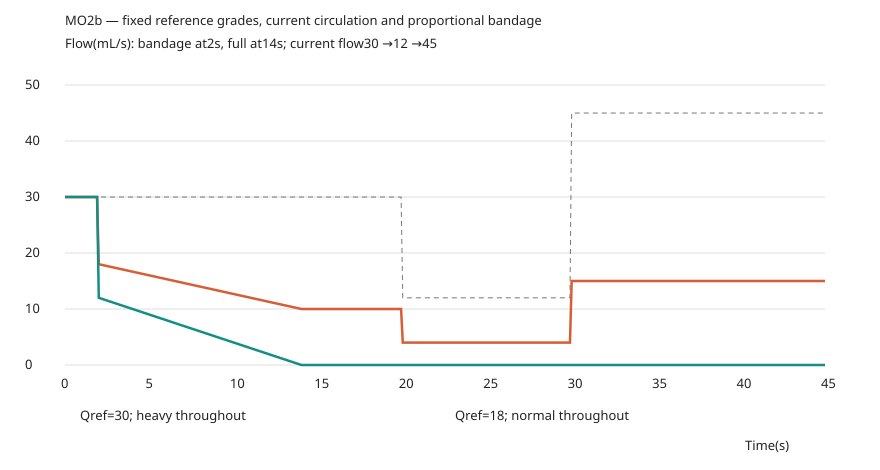

# MO2b — 기준 유량·내구도·움직임 확률

브랜치 `feature/medical-overhaul`, 기준 `efeda39`([MO2 기록](mo2-hemostasis.md)). [사용자 지시서](mo2b-instructions.md)를 반영한 의료 개편 중간 단계다. [검증·정책 대장](mo2b-ledger.json)과 [전체 수치](mo2b-numerical-results.json)를 함께 본다.

## 고정 기준 유량

등급과 붕대 비율은 **상처 생성 시 Qref**로 결정한다. 기존 S1의 MAP93mmHg·안정 심박출량5250mL/min(87.5mL/s)을 사용한다(**원본**). 과다 경계20mL/s는 유지한다(**튜닝**). 상처 생애 동안 고정하는 정책, 비례 차단, 제거 후 절반 복귀는 **사용자 설계값**이다.

기존 B1 엔진을 복제한 상태에서 `dt=0`으로 평가한다. 현재 혈압·혈액 가용량·심정지·운동·치료 효과를 기준 순환으로 대체하고, 실제 상처/공유 혈관의 손상·자연지혈·확인된 피부 개구·사지 구획 상태는 생성 시점 그대로 읽는다. 심박 위상의 순간 피크 대신 기준 압력의 정규화 유량을 쓴다. 겉/사지 내부/체강 성분과 합계를 고정한다. 같은 사격에서 생성된 상처는 피부 개구부 등록 뒤 같은 시점에 평가한다.

고정값은 **상처 객체 수명에 연결된 WeakMap 메타데이터**다. 기존 의료 JSON과 v69 스냅샷에 새 필드를 더하지 않는다. 조회는 `TrainingMedical.referenceFlows`와 의료 표시 모델의 `wound.reference`로 제공한다. 환자 상태를 향후 별도 저장/복원할 때에는 이 메타데이터도 저장해야 한다. 현재 게임은 기존처럼 환자 상태 저장/복원 기능을 추가하지 않는다.

후속 상처가 생겨도 이전 Qref를 다시 쓰지 않는다. 다음은 같은 대퇴동맥에 동일한 두 손상을 순서대로 만든 실제 B1 평가 예다.

| 시점 | 첫 상처 Qref | 새 상처 Qref | 현재 실제 혈관 총유량 | 실제 출혈원 수 |
|---|---:|---:|---:|---:|
| 첫 상처 생성 | 87.50 | — | 87.50 | 1 |
| 같은 혈관 두 번째 상처 | 87.50(유지) | 43.75 | 87.50 | 1 |

단위mL/s. 두 번째 상처는 그 순간 기존 면적 배분에 따라 절반을 받는다. 고정 참조값의 합은131.25가 되지만 **혈액 장부에는 현재 공유 혈관 유량87.5만 한 번** 넣는다. Qref는 등급/붕대의 기준이며 합쳐서 혈액 손실로 사용하지 않는다.

## 붕대 비율과 회복

`f=min(1,20/Qref겉)`로 현재 겉 유량을 차단한다. 완료 즉시 `0.6f`,12초에 `f`가 되는 기존 시간 곡선을 유지한다. 내부 유출은 그대로다. Qref겉이0이면 외부 유량도 없으며 분모0을 만들지 않는다. 푼 뒤의 현재 겉 유량은 `현재겉×(1−0.5f)`다. 사용4초·2회·제거2초·중복 감기 거부·거즈류 마무리·자원 예약은 MO2 그대로다.

| Qref겉 | f | 현재=Qref일 때 감은 뒤 | 풀고 난 뒤 | 현재 겉12일 때 푼 뒤 |
|---|---:|---:|---:|---:|
| 100 | 0.2 | 80 | 90 | 10.8 |
| 40 | 0.5 | 20 | 30 | 9 |
| 20 | 1 | 0 | 10 | 6 |

위100/40/20은 비율식 시험용 입력이며, 실제 생성값은 기준 CO의 공유 예산으로 제한된다.

과다 Qref30인 같은 상처의 현재 유량을30→12→45로 바꾸면, 등급은 계속 과다이며 완성 붕대 후 실제 유량은10→4→15다. Qref18인 일반 상처는 같은 현재 유량에서도 완성 붕대 후0이다. 이제20은 기준 순환에서의 경계이지 현재 유량의 절대 차단 상한이 아니다.



실제 대퇴동맥 피격→CAT→주입기→CAT 제거 후 기존 전혈팩을20초 연결하고180초 주입하는 경로도 확인했다. 혈액량 4488.55→4988.55mL, 주입량 500mL 동안 Qref87.5와 과다 등급이 동일했다. 약물·수혈 식과 속도는 바꾸지 않았다.

회복 조건은 유지한다. 일반 상처가 실제 멎고, 과다는 거즈류가 완전히 제어해야 한다. 현재 유량이 일시적으로0이거나 혈압이 낮아져도 과다 상처가 붕대만으로 처치 완료가 되지 않는다. 모든 상처 완료·CAT 없음, 샘/터짐/새 상처에서의 중단·재개, 기존 회복 곡선·최대HP·골절/장기 상태는 그대로다.

## 분포와20의 적절성

기존240+28조건의258상처를 동일 순서로 검사했다. 현재 순환의 미처치 결과는 MO2 조사와 바이트 동일하다. 아래는 MO2와 같은234개 비교집단(현재 출혈>0·심정지 제외)에 새 Qref를 적용한 값이다.

| 그룹 | 수 | 최소 | 25% | 중앙 | 75% | 90% | 최대 | 20 기준 |
|---|---:|---:|---:|---:|---:|---:|---:|---|
| 주요 혈관 | 47 | 10.222 | 47.143 | 87.500 | 87.500 | 87.500 | 87.500 | 과다45/47=95.74% |
| 나머지 | 187 | 0.607 | 3.237 | 10.200 | 14.340 | 26.350 | 42.770 | 일반163/187=87.17% |

| 경계mL/s | 주요 혈관 과다 비율 | 나머지 일반 비율 |
|---|---:|---:|
| 15 | 95.74% | 77.01% |
| 20 | 95.74% | 87.17% |
| 25 | 91.49% | 88.24% |
| 30 | 87.23% | 94.65% |

Qref가 양수인 **모든250상처**도 별도 집계했다. 주요 혈관47개는 같고 나머지203개 중 일반179개(88.18%)다. 생성 직후 심정지로 현재 유량이0이 된 상처16개도 참조 순환에서는 양수라 포함된다. 현재 순환의 정지로 참조 등급을 일반으로 내리지는 않는다. 양쪽 집단에서20은 주요 혈관 과다와 나머지 일반을 구분하는 시작값으로 여전히 적절해 유지했다.

## 내구도와 대표 상처

주입기180·거즈250·폼350, **효율 모두1**은 이번 **사용자 설계값**이다. 고정 시간5/6/7초, 혈관/원래 통로 단면에 근거한 작업점 계산과 범위는 MO2 그대로다. 24개 대표 상처의 작업점·성분은 MO2와 정확히 같다. 물품 무게·크기·지급 위치도 바꾸지 않았다.

| 7N6 대표 상처 | 작업점 | 거즈250 | 주입기180 | 폼350 |
|---|---:|---:|---:|---:|
| 대퇴동맥/왼다리 | 167.59 | 1건 | 1건 | 2건 |
| 폐/가슴 | 21.84 | 체강 범위 제외 | 8건 | 16건 |
| 간 중심/복부 | 31.46 | 체강 범위 제외 | 5건 | 11건 |
| 간 후측면/복부 | 267.99 | 체강 범위 제외 | 0건(부분) | 1건 |

같은 독립 상처를 치료할 수 있는 내림 정수다. 거즈의 겉 성분만으로 체강까지 완료했다고 세지 않는다. 주입기는 빠르고, 거즈는 더 많은 자원, 폼은 가장 큰 용량과 가장 긴 사용시간을 갖는다. 잔량 부족 후 이어서 처치·완료 시 필요한 만큼 소비·취소 시0소비는 유지한다.

## 움직임 확률

사용자가 정한 **30초 누적 경험 목표**에 기존500시드(`0x740000+i`)·60Hz 시험을 맞췄다. 실제 실행 함수를 사용하며 정지·웅크림·마무리 붕대는0건이다.

| 상태 | 샘 경험 | 터짐 경험 | 샘 사건 수 | 터짐 사건 수 |
|---|---:|---:|---:|---:|
| 정지 | 0/500 | 0/500 | 0 | 0 |
| 웅크림 | 0/500 | 0/500 | 0 | 0 |
| 걷기 | 225/500=45% | 35/500=7% | 260 | 35 |
| 달리기 | 275/500=55% | 300/500=60% | 347 | 300 |
| 붕대 마무리 후 걷기·달리기 | 0/500 | 0/500 | 0 | 0 |

최종 위험률은 걷기 샘0.0197756/s·터짐0.003146/s, 달리기 샘0.0472758/s·터짐0.029072/s다(**목표는 사용자 설계값, 역산 위험률은 튜닝/게임 허용**). 샘 중8초 동안 새 샘을 억제하고, 터진 뒤에는 다음 처치 전까지 제외되며, 사건 난수 소비 순서가 달라져 단순한 `−ln(1−p)/30`과 다르다. 같은 시드 반복 결과와 실제 `stepCareMovement` 경로가 일치한다.

한 틱의 사건은 샘 또는 터짐 하나다. 터짐을 추가 샘으로 세지 않는다. 앞선 별도 샘을 겪고 나중에 터진 사람은 두 **누적 경험 집합**에 속할 수 있다. 달리기 목표55%+60%는 이러한 겹침을 포함한다. 샘0.3mL/s·8초, 터짐 후 진행55% 복귀와 회복 중단은 유지한다. 고정500시드에 보정한 경험 비율이며 모든 시드 집합에서 같은 정수 비율을 보장한다는 뜻은 아니다.

## MO2 검사에서 의도적으로 달라진 값

| 항목 | MO2 | MO2b | 이유 |
|---|---|---|---|
| 등급 | 현재 Q0 | 생성 시 Qref | 혈액 손실·수혈로 상처 등급이 바뀌지 않음 |
| 과다 Qref30, 현재30/12/45, 붕대 완성 | 10/0/25 | 10/4/15 | 고정 비율로 차단 |
| 일반18의 붕대 초기 실제 유량 | 6 | 7.2 | 한계20의60% 대신 고정f의60% |
| 일반18의 붕대 제거 후 유량 | 8 | 9 | 절대10 대신 f/2 유지 |
| 주입기/거즈/폼 | 160×1.2/100×1/300×1.8 | 180/250/350×1 | 사용자 지정 용량/효율 |
| 대퇴동맥 상처 수(거즈/주입기/폼) | 0/1/3 | 1/1/2 | 작업점은 동일, 자원량만 변경 |
| 걷기 샘/터짐 | 66%/11.4% | 45%/7% | 500시드 보정 |
| 달리기 샘/터짐 | 0%/98% | 55%/60% | 달리기 샘 허용·터짐 완화 |

기존 테스트를 건너뛰거나 원래 골든을 갱신하지 않았다. MO2 검사 중 위 정책에 해당하는 기대값만 바꾸고 기준 유량·후속 공유 혈관·현재0유량·복제 계산의 원본 보존 검사를 추가했다. 이전 검사 스크립트 원문은 [보존 폴더](history/mo2b-superseded/)에 있다.

## 재현·화면

```sh
npm ci
npm run build
npm test
npm run verify:reference
node scripts/verify-mo2-preserved.mjs artifacts/qa/mo2b/preserved.json
node scripts/verify-v69.mjs --calculations-only
node scripts/fit-mo2b-movement.mjs
node scripts/check-mo2b.mjs
node scripts/check-mo2b-browser.mjs
npm run test:browser
node scripts/report-mo2b.mjs
```

빌드·테스트는 순차 실행한다. `report-mo2b`에는 `artifacts/qa/mo2b/unit-tests.log` 또는 인자로 전달한 전체 테스트 로그가 필요하다. 원본 실행 HTML의 오프라인 검사 해시가 최종 빌드와 같아야 대장을 쓴다. Actions는 사용하지 않는다. 전체 HTML 바이트 일치 대신 변경하지 않은 수치·고정 원본과 의도적 정책 차이를 각각 검증한다.

실제 `traceShot`으로 만든 같은 상완 상처를 PC 클릭·휴대폰 터치로 확인한다. 임의 부상 정규화 없이 현재 유량49.91→30.28→18.69mL/s로 감소해도 Qref49.665와 **과다출혈**은 고정이다. 거즈 부족 시험만 기존처럼3점을 사용한다. 환자의 기존 피격/후속 의료 계산을60Hz로 진행하고 화면을 캡처한다. 작은 체강 출혈은 CAT로 막히지 않으며 주입기가 완료한 뒤0이 되는 MO2 경계도 유지한다.

| 화면 | 1280×720 | 844×390 |
|---|---|---|
| 출혈 진행 전 | [PC](media/mo2b/1280-reference-before-loss.webp) | [모바일](media/mo2b/844-reference-before-loss.webp) |
| 실제 혈액 손실 후 | [PC](media/mo2b/1280-reference-after-loss.webp) | [모바일](media/mo2b/844-reference-after-loss.webp) |
| 현재 Q0가20 아래여도 과다 유지 | [PC](media/mo2b/1280-partial.webp) | [모바일](media/mo2b/844-partial.webp) |
| 지혈·부위 HP 회복 완료 | [PC](media/mo2b/1280-recovered.webp) | [모바일](media/mo2b/844-recovered.webp) |

최종 시험 수·600틱·오프라인·보존 해시는 대장에 기록한다. 실제 폰 하드웨어 성능은 미측정이다. MO2의 처치 범위·회복/지혈대·약물/수혈/흉부 임시 정책·피격·탄도·방호·상처 통로·손상량 계산은 바꾸지 않았다. 주입기 제원과 미세혈관 등가 면적의 기존 추정 튜닝 한계도 그대로다.
