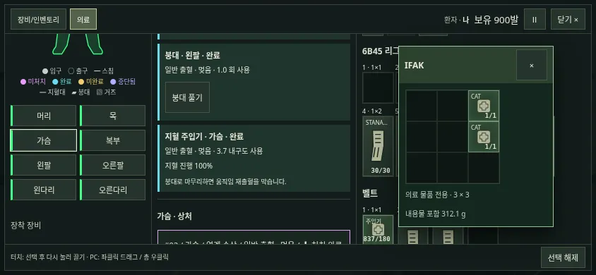
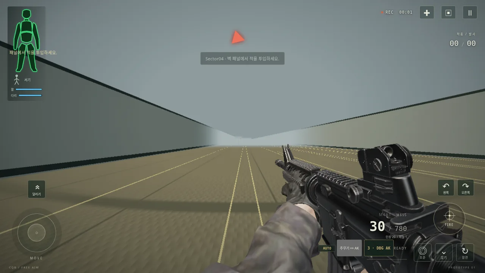
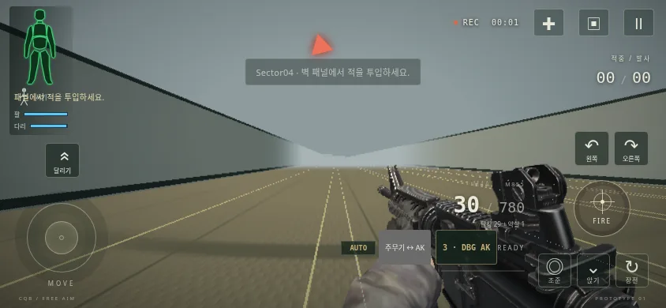

# MO3 — 혈관 상한·단일 출혈·폐 스태미나

`feature/medical-overhaul`, 기준 `d349025`(MO2b). [지시서](mo3-instructions.md), [정책·검증 대장](mo3-ledger.json), [전체 수치](mo3-numerical-results.json), [혈류 출처](mo3-sources.md)를 함께 본다. 의료 개편 중간 단계이며 main은 바꾸지 않았다. 심장·감염(MO4), 약물·수혈 재작성(MO5), 수술은 이번 범위가 아니다.

## 동작

상처마다 실제 출혈량 하나를 가진다. 출혈원의 소속은 혈관·장기가 있는 해부학 부위다. 같은 사격의 해당 부위 상처가 있으면 거기에 연결한다. 없으면 `medical.bleedingWounds`에 **연계 손상**을 만든다. 가짜 입·출구나 추가 탄환 피격·HP 피해는 만들지 않는다. UI에는 피부 개구 없는 연계 손상이라고 표시하고 같은 방식으로 처치한다. 이전 사격에서 이미 치료한 상처로 신규 손상을 옮기지 않는다.

겉/사지 구획/흉강/복강/후복막 목적지, 혈액 저류·구획 용량·압박·충만, 혈흉 폐 압박을 삭제했다. 원래 출혈원별 자연지혈은 유지한다. 혈액 차감은 실제 유량×dt를 한 번만 적용한다. 기존 소비자와 연결되는 `externalBleedRate`/`_effExternal`은 이제 **전체 단일 유량의 호환 별칭**이고 internal 별칭은0이다. 이 이름으로 겉/내부를 계산하거나 표시하지 않는다. 상처의 정식 필드는 `bleedRateMlPerS`, 누적 장부는 `bloodLossMl`이다.

붕대·거즈·주입기·폼은 머리 포함 모든 부위·출혈원을 다룬다. 피부 개구/체강/머리 범위 거부는 없다. 붕대는 `min(1,20/Qref.total)`을 차단한다(초기60%→12초). 고정 Qref·등급, 제거 후 절반 차단, 부분 거즈 진행, 마무리 붕대·움직임 재출혈, HP 회복 조건은 MO2b 그대로다. CAT는 해당 사지에 **소속된 모든** 출혈을 멈춘다. 팔 피격에서 공동으로 손상된 폐는 흉부 소속이므로 팔 CAT가 막지 않는다.

| 제품 | 자원 | 고정 시간 | 범위 |
|---|---:|---:|---|
| 붕대 | 2회 | 4초 | 모든 부위 |
| 거즈 | 250 | 6초 | 모든 부위 |
| 주입기 | 180 | 5초 | 모든 부위 |
| 폼 | 350 | 7초 | 모든 부위 |
| CAT | 1개/사지 | 장착5초·제거2초 | 해당 사지 전체 |

작업점은 옛 성분별 작업점의 **합계**를 한 lesion 비용으로 보존한다. 3점/mm², 성분 최소2점, 장기 등가 개구=원래 해당 통로 단면5%를 유지한다. 소량 개구에서 옛 최소값 합계가 달라지지 않도록 옛 개구별 `.85/.15`, `.4/.6`은 **자원 비용 계산에만** 남겼다(`medical-work.js`). 혈액 분배·유량·저류와는 연결되지 않는다. 합산 순서가 바뀐 간 후측면 사례의 총합 차이는 약5.7e−14점이다.

## 혈관 상한

이름 붙은 혈관마다 정상 유량×k를 상한으로 둔다. `k=6`은 **근거 미확보 게임 튜닝**이다. 정상 유량 자료와 환자/측정 부위 차이, 추정 매핑은 [출처표](mo3-sources.md)에 표시했다. 공개 대퇴부 총상 사례의 사망 등록 시각을 완전 절단의 통제 실험값으로 사용하지 않았다. 기존 심정지→사망300초가 남아 있어 임상 사망 시간에 맞춘 k라고 주장할 수 없다.

구멍 유량 식 `Cd·A·sqrt(2·MAP/ρ)`와 현재 CO 총량 제한은 유지한다. 간·비장·신장의 장기 유량×2/3도 그대로다. 같은 이름의 여러 lesion은 혈관 상한을 공유한다. 모델의 근위/원위 슬와동맥도 한 혈관 ID로 묶는다. 실제 장면 대퇴동맥 지름8.2457mm에서 상한 아래 크기별 차이를 확인했다.

| 영구 통로 반경 mm | 개구 mm² | 원식 mL/s | 상한 후 mL/s |
|---:|---:|---:|---:|
| 0.05 | 0.6476 | 1.9421 | 1.9421 |
| 0.10 | 1.2952 | 3.8841 | 3.8841 |
| 0.20 | 2.5905 | 7.7682 | 7.7682 |
| 0.50 | 6.4761 | 19.4206 | 19.4206 |
| 1.00 | 12.9523 | 38.8412 | 28.4000 |
| 2.00 | 25.9045 | 77.6823 | 28.4000 |
| 4.00 | 51.8091 | 155.3646 | 28.4000 |

## Qref 분포와 대표 상처

240S0+28단일 피격에서 양수 Qref250개를 조사했다. 주요 혈관 연결47개, 나머지203개다. 즉시 심정지로 실제 흐름0인 경우에도 양수 참조값은 포함한다. 주요 혈관 중앙값87.5→28.9mL/s, 나머지 중앙값9.67 유지. **경계20을 유지**한다.

| 경계 mL/s | 변경 전 주요 과다/47 | 변경 후 주요 과다/47 | 변경 후 나머지 일반/203 |
|---:|---:|---:|---:|
| 15 | 45 | 45 | 160 |
| 20 | 45 | 45 | 179 |
| 25 | 43 | 43 | 181 |
| 30 | 41 | 21 | 193 |

아래 합계는 **사격 경로 전체**다. 서로 다른 부위·상처는 각각 선택해 처치해야 한다. 한 제품으로 여러 상처를 치료할 수 있는지는 각 행의 상처별 비용과 잔량으로 결정한다. 표의 개수는 자원량 환산이며 사용 행동 횟수와 다르다. 상처별 Qref·작업점·제품별 완전 상처 수와 필요한 물품 수는 전체 수치 JSON에 있다.

| 경로(7N6) | Qref 합 mL/s | 옛 작업점 합 | 새 작업점 합 | 거즈/주입기/폼 총 자원 환산 개수 |
|---|---:|---:|---:|---:|
| aorta | 87.500 | 추가 경로 | 570.956 | 3/4/2 |
| lung-only | 1.053 | 21.842 | 21.842 | 1/1/1 |
| liver | 16.514 | 56.785 | 56.785 | 1/1/1 |
| femoral-artery | 28.900 | 167.589 | 167.589 | 1/1/1 |
| liver-central | 24.509 | 38.845 | 38.845 | 1/1/1 |
| femoral-complete | 28.900 | 167.589 | 167.589 | 1/1/1 |
| femoral-partial | 28.900 | 132.372 | 132.372 | 1/1/1 |
| liver-posterior | 70.528 | 298.050 | 298.050 | 2/2/1 |
| subclavian-direct | 87.500 | 추가 경로 | 408.613 | 2/3/2 |

`subclavian-direct`는 쇄골하동맥과 대동맥을 함께 지나는 실제 경로다(전체 장기 교차 목록도 기록). 대동맥 상처570.96점은 거즈·주입기·폼 한 개로 끝나지 않는다. 임의로 상처를 약화시키지 않았다.

## 폐와 남은 호흡 경로

폐 원시 손상량·직접/공동 구분을 유지하고 폐 전용 호흡·산소·기흉·혈흉·판막·의인성·재발 모델과 UI/기록을 제거했다. `generated/legacy-medical.js`는 **3D 소유 포트**로 명시적으로 수정했으며 고정2D를 재추출하지 않았다. 범용 가슴 피격의 즉시 호흡 저하도 제거했다.

좌우 `d`는 기존 S1의 `severity`(기존 유효 손상 체적 기반 값)를 읽는다. 같은 탄환·같은 폐의 중복 부위 노출은 max, 다른 피격은 `1−Π(1−d)`로 합친다(**결합식 튜닝**). 레이드 내 HP 회복으로 d는 줄지 않는다. 다리 최대치에 `1−.25*(d좌+d우)`를 한 번 곱한다. 기존 회복량도 legMax에 비례하므로 회복 배율을 또 곱하지 않는다. 일반 가슴 HP에는 별도 스태미나 배율을 추가하지 않았다.

| 폐 입력 | 다리 최대치 | 휴식 회복/초(정규화) | 고정 건강 순환의 첫 질주 |
|---|---:|---:|---:|
| 없음 | 1 | 1/24 | 32초 |
| 왼쪽 d1 | .75 | .75/24 | 24초 |
| 오른쪽 d1 | .75 | .75/24 | 24초 |
| 양쪽 d1 | .5 | .5/24 | 16초 |

위 표는 **의료 정규화를 하지 않는 독립 activity 입력 검사**다. 실제 생리·운동을 모두 진행한 폐 단독 피격의 첫 질주는 다음과 같다. 기존 운동 산소 수요·혈액 손실 등도 함께 작용하므로 위 고정 순환 표와 같은 시간이 아니다.

- MO2b d349025: 11.2167초, stamina-empty, 종료 legMax 0.375324, 호흡 97.503.
- MO3: 11.6333초, stamina-empty, 종료 legMax 0.376463, 호흡 100.000.

작은 폐 피격에서는 폐 호흡 악화를 없앤 이득이 새 부분 스태미나 손실보다 커 실제 질주가 조금 길어졌다. 운동/순환 식을 이번 작업에서 보정하지 않았다. 실제 P01 캡처는 좌폐 d=.0815128242, 우폐0, 최대치97.9621794%이며 두 화면에서97.96%로 표시된다.

목 기도(S1), 뇌간(S0), 척수A대 무호흡(R2), OTFC(M4b) 호흡 억제, 비흉부 머리 폭압의 원래 반응은 유지한다. 저혈량·심장·운동으로 산소가 변하는 것도 유지한다. 폐 단독 실제 trace 뒤 동일 출혈/HP의 폐 효과 없는 대조군과300초 비교해 호흡·산소가 같은지 확인했다. 폐 관통 직후 및300초 호흡100, 기흉·흉부 처치 모델 필드 없음.

## 전후 생리와 물품

| 경로 | 전60초 손실 mL | 후60초 손실 mL | 전60초 호흡 | 후60초 호흡 |
|---|---:|---:|---:|---:|
| aorta | 1604.817 | 1600.905 | 79.184 | 100.000 |
| lung-only | 21.411 | 22.039 | 85.775 | 100.000 |
| femoral-artery | 2043.333 | 1680.856 | 100.000 | 100.000 |
| liver-central | 1036.678 | 1036.678 | 100.000 | 100.000 |
| liver-posterior | 1991.349 | 1991.349 | 100.000 | 100.000 |

옛 사지 충만 모델은 유출 목적지 비율만 바꾸고 총 유량 자체는 줄이지 않았다. 따라서 그 분배 제거만으로 총 손실이 늘지는 않는다. 폐 단독 손실의 작은 증가는 폐 호흡/순환 악화 제거에 따른 변화다. 대표 자료는 [60Hz 전후 기록](mo3-physiology-comparison.json)에 있다. 대퇴동맥 완전 손상의 쓰러짐27.783→60.933초, 심정지85.800→121.517초, 사망385.800→421.517초. 간 중심은155.233/556.650/856.650초로 같다. 사망 지연300초는 MO4 전까지 그대로다.

씰·감압 바늘·NPA는 정의/지급/적 장비/상자/복원 생성/옛 의료 자원에서 제거했다. 환자 상태 저장 기능은 원래 없고 설정만 저장한다. 삭제된 ID로 createMedicalSupply 복원을 요청하면 거부한다. IFAK는 거즈(0,0)1×2, CAT(2,0)/(2,1), 붕대(0,2)다. 빈(1,0)/(1,1)/(1,2)/(2,2)을 채우거나 재배치하지 않았다. 축소 시험 인벤토리 의료 질량 .54360203978125→.4684758035kg, 약75.13g 감소.

## 검증과 재실행

전체489/489, 실패·스킵0. 고정2D 3,641,864bytes와 원래 SHA 유지. 보존 검사136파일은 자산, 탄도·관통·방호·손상 통로·내부 도형·피해 계산, 변경하지 않은 generated 포트를 검사한다. 의료 generated만 명시적 변경 대상이다.

240S0+28단일 피격 모두 trace·원시 손상/통로·즉시 HP 동일. 즉시 실제 출혈량은 S0의22조건/단일6조건, 호흡은40/4조건에서 의도적으로 다르다. 즉시 산소는268조건 동일하다. 전체 의료 JSON은 단일 유량/출혈원 소속/삭제 모델 스키마 때문에 모두 다르다. v69 골든을 덮어쓰지 않고 `tests/fixtures/mo3/golden.json`에 새 기준을 추가했다. 684채널과 젤5종은 v69 바이트 해시와 같다.

M4/AK 각600틱 카메라·총구·방향·반동·사격 수가 v69와 같다. 건강 의료의 혈액·의식·통증·쇼크·심박·호흡·생사 수치도 같다. 전체 JSON의 스키마 차이는 허용된 변경으로 기록한다. 두 화면의 실제 클릭/터치 처치, 연계 흉부 상처 선택·주입기 지혈, 폐 피격 HUD, 정확한 HTML 오프라인 검사는 대장에 기록한다. 실제 폰 하드웨어 성능은 미측정이다.

```sh
npm ci
npm run build
npm test
npm run verify:reference
node scripts/verify-mo3-preserved.mjs
node scripts/mo3-capture.mjs artifacts/qa/mo3/current.json
node scripts/check-mo3.mjs
CHROMIUM_PATH=/usr/bin/chromium node scripts/check-mo3-600.mjs
CHROMIUM_PATH=/usr/bin/chromium node scripts/check-mo3-browser.mjs
CHROMIUM_PATH=/usr/bin/chromium node scripts/check-mo3-lung-ui.mjs
CHROMIUM_PATH=/usr/bin/chromium node scripts/check-migration-offline.mjs
```

빌드/테스트는 순서대로 실행한다. 구형 verify:v69·verify:preserved·test:browser는 이관 당시 전체 동일성 검사이므로 현재 의료 스키마를 의도적 차이로 보고한다. 위 MO3 검사가 이를 대신한다. 과거 테스트 원문과 이전 보고 도구는 `docs/history/mo3-superseded/`에 보존했다.




