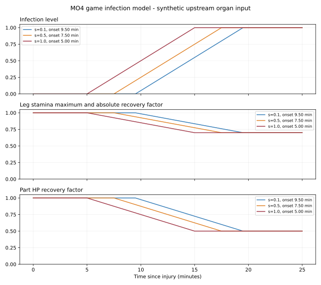
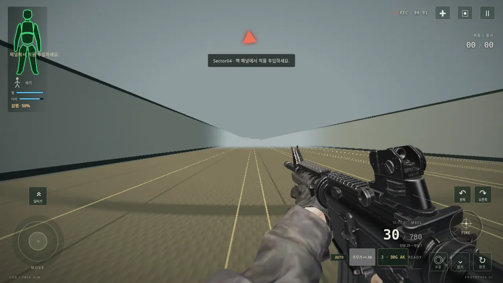
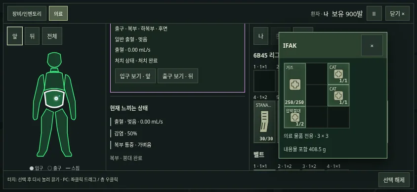
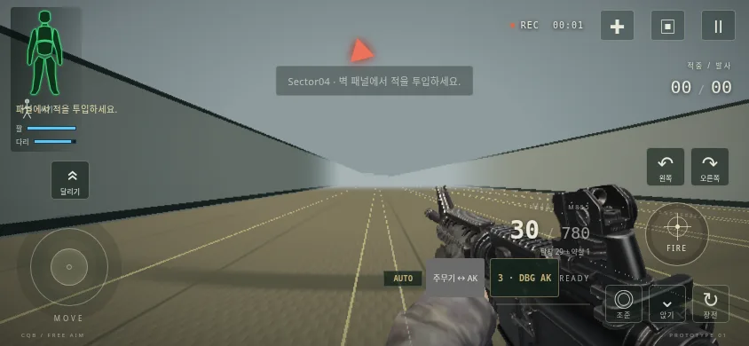

# MO4 — 심장 치명·속 빈 장기 감염·MO3 보정

`feature/medical-overhaul`, 기준 `b52adf2`(MO3). [지시서](mo4-instructions.md), [정책·검증 대장](mo4-ledger.json), [전체 수치](mo4-numerical-results.json), [혈관·심장 분류표](mo4-tables.md), [출처와 튜닝](mo4-sources.md)을 함께 본다. 의료 개편 중간 시험판이며 `complete:false`다. main 병합·전체 완료판 배포·Actions는 하지 않는다.

## 동맥과 폐

이름 붙은 동맥은 `max(정상 유량/60 × k6, 25)`mL/s를 상한으로 쓴다. k6·정상 혈류 매핑은 MO3 그대로다. 정맥·큰 동맥·장기 실질 상한, 개구 유량 식, 혈관별 공유 상한, 현재 CO 예산, 자연지혈은 바꾸지 않았다. 상한25는 실제 혈류를25로 강제하는 값이 아니다. 작은 개구·저혈압·여러 출혈원의 CO 공유는 여전히 흐름을 제한한다.

S0+단일268조건의 Qref 양수250개 분포는 전후 같다. 이 표본에는 이번에 상한이 늘어나는 팔다리 동맥 경로가 부족하다. 별도 실제 P01 상완 피격을 MO3 UI 기록과 비교하면 **손상량은 동일**, 팔 Qref가3.3→25.5mL/s, 일반→과다로 바뀐다. 연결된 미세 흉부 상처 .075175mL/s는 그대로다. 두 화면은 같은 사례이므로 분포에서는 한 번만 센다.

| 경계 mL/s | 원268조건 주요 과다(전=후)/47 | 원268조건 나머지 일반/203 | 상완 추가 후 주요 과다 전→후/48 |
|---:|---:|---:|---:|
| 15 | 45 | 160 | 45→46 |
| 20 | 45 | 179 | 45→46 |
| 25 | 43 | 181 | 43→44 |
| 30 | 21 | 193 | 21→21 |

경계20을 유지한다. 최소 동맥 상한25보다 경계가 낮으므로 충분한 개구가 과다로 전환되고, 작은 개구는 일반에 남는다. 경계30은 단독 상한25인 동맥을 놓친다. 모든 주요 손상·정맥·장기 출혈을 완벽히 나누는 임상 분류라는 뜻은 아니다. 혈관별 개구 전환표는 MAP93 기준이며 CO 공유/피부 삼출의 조건을 명시했다.

폐는 좌우 각각 `min(.25, g*d)`, 전체 다리 최대치 배율은 `1−손실좌−손실우`다. `g=1.4117698367631553`. 같은 탄·같은 폐 max, 다른 탄 `1−Π(1−d)` 결합과 원시 손상은 유지한다. legMax에 한 번만 곱하고 기존 최대치 비례 회복에 다시 곱하지 않는다. HP 회복도 폐 손상을 지우지 않는다.

| 실제5m 피격 | 원시 d | 직접 관통 다리 최대치 손실 | TC만 스침 d | TC 손실 |
|---|---:|---:|---:|---:|
| 5.45 PS / AK | .08854134 | 12.5000% | .00083945 | .1185% |
| M855 / M4 | .08208148 | 11.5880% | .01728065 | 2.4396% |
| M80 / SCAR-H | .15727616 | **22.2038%** | .05976066 | 8.4368% |

모두를10–15%로 맞추는 공통 g 구간은 `[1.21830, .95374]`로 **공집합**이다. 원래 손상량·탄도·방호를 보존하고 세 직접 손상 d의 중앙값을12.5%에 맞췄다. M80은 목표 미달이다. 탄종별 임의 배율이나 손상량 변경으로 숨기지 않았다. TC-only는 동일한 팔 인접 격자에서 직접 폐 접촉이 없는 양수 사례 중 최소 d를 택한 보조 관측이며 대표성 있는 임상 표본이 아니다. 실제 표적/방향·공동 교차 목록·무기별 실제 초속은 수치 JSON에 있다.

## 심장

기존 실패 조건 **`pumpFunction<=.05 && isUnconscious && oxygenDelivery<.25`**가 성립하면 원래 심정지 진입 전에 치명 결과를 고정하고, 같은 틱에 사망시킨다. 직접 여부·통로 길이·원시 심각도·펌프·산소·시각을 보존한다. 직접/공동 손상으로 펌프를 만드는 S0 수식과 의식·심박출·혈압·리듬 위험 계산은 그대로다. 일반 심정지의 사후 원인 문자열이 우연히 `cardiac_pump_failure`인 것만으로 즉사시키지 않는다.

**피격 직후와 치명 판정 직후는 다르다.** 원래 의식/산소 조건을 기다리는 경로는 피격 후 약8.7667초에 치명 판정에 도달한다. 이번에 없앤 것은 그 뒤300초 사망 대기다. 임계값·예비 의식 시간을 바꿔 피격 순간 무조건 죽게 하지 않았다. 조사38조건 중10치명은 결정→사망0초,20비치명 손상은 순환/리듬 시계열 동일,8방호 차단은 심장 손상 없음이다.

확정 치명은 붕대·거즈·HP 회복으로 되돌릴 수 없다. 나머지 출혈/저혈량/일반 심정지→300초 경로는 유지한다. 기존 뇌간 경로를 확인하면 즉시 의식 소실·심정지 후300초 사망이다. 문서의 “기존 즉시 치명” 표현에 맞추려고 그 동작을 새 즉사로 바꾸지 않았다. 기존 래그돌·시점·사망 UI 경로도 수정하지 않았다.

## 감염

감염은 실제 `s1OrganDamage`의 원시 severity·유효 손상 체적을 읽는다. 직접/공동 모두 대상으로, 서로 다른 상처는 `1−Π(1−s)`로 합친다. 같은 상처·같은 장기의 중복 입력은 max로 중복을 제거한다. 지혈용 연계 상처를 새 피격으로 세거나 회복된 HP로 severity를 재계산하지 않는다.

**현재 도형의 한계:** 장은 `bowel` 하나이며 소장/대장이 분리돼 있지 않고, 위·방광 콜라이더는 없다. 현재 실제 피격은 이 장 도형에 연결했다. 위·소장·대장·방광 입력도 받을 수 있지만 새 도형·가짜 피격을 만들지 않았다. 없는 장기는 상류 손상 입력의 독립 검사로만 검증했다. 추가 속 빈 구조는 목/흉부/복부 식도3개다. 기도2개도 목록에 있으나 소화/비뇨 감염 대상이 아니다. 식도·기도·고형 장기·심장·폐·뇌·척수는 이번 감염에서 제외한다. 담낭·요관 도형도 없다.

피격별 묶음의 `잠복=600−300*s`초, 스킬 배율1이다. 여러 피격은 각각 자기 시계로 잠복하며 가장 먼저 끝난 시점부터 증상이 시작된다. 나중 피격이 앞의 잠복을 리셋하거나 과거 시작 시각을 당기지 않는다. 이 세부 결합과600초 악화는 튜닝이다. 전체 severity는 전 피격의 합집합이며, severity가 최종 상한을 낮추지는 않는다.

| s | 잠복 | 증상 후 최대까지 | 최대 다리 최대치/회복 | 최대 부위 HP 회복 |
|---:|---:|---:|---:|---:|
| .1 | 570초 | 600초 | ×.7 | ×.5 |
| .5 | 450초 | 600초 | ×.7 | ×.5 |
| 1 | 300초 | 600초 | ×.7 | ×.5 |

감염 수준 L은 증상 시작 뒤600초 동안0→1로 선형 증가한다. 다리 배율 `1−.3L`은 폐·기존 reserve에 곱한다. 회복은 기존 legMax 비례로 한 번만 감소한다. 부위 HP 회복식 전체(최소 회복량 포함)에 `1−.5L`을 곱하며 최대 HP는 바꾸지 않는다. 감염이 직접 혈액·의식·HP를 깎거나 사망시키지 않는다. 열·시야·항생제 아이템·새 효과 시간은 추가하지 않았다.

`setInfectionControl({progressionRate,reductionPerS})`는 MO5 연결부뿐이다. 기본1/0이며 현재 아이템은 호출하지 않는다. 지혈·HP 회복·탭 전환으로 감염은 지워지지 않는다. 메뉴 일시정지는 의료 시계와 함께 멈추고 새 환자 reset은 새 상태다. 잠복 중 의료탭/HUD에는 표시하지 않으며 증상 시작 후 `감염 · N%`를 표시한다. 내부 QA 스냅샷은 잠복을 관측할 수 있다.



## 검증과 재실행

전체501/501, 실패·스킵0. MO3의 trace·원시 손상·즉시HP는240+28조건 동일,684채널·젤5종도 동일하다. 즉시 출혈·호흡·산소는 이268조건에서 모두 같고, 상완 보조 사례만 출혈/Qref가 의도적으로 다르다. 전체 의료 스냅샷은 감염 등록 등으로 S0의32조건·단일16조건이 달라진다. 심장 치명 후 사망·폐 스태미나·감염 후 효과는 별도 의도적 변화다. 구 MO3/v69 골든을 보존하고 `tests/fixtures/mo4/golden.json`을 추가했다. 변경하지 않은3D 런타임·자산·고정2D 총293파일 SHA를 검사한다.

두 화면의 실제 P01 장 피격·네이티브 붕대 사용 뒤 HP가 최대치로 돌아와도 감염은 남는다. 60Hz 의료 시계만 가속해 잠복 종료 전/증상50%를 캡처했다. 생산 코드의 의료탭/HUD이며 환자의 HP·출혈·감염을 정규화하지 않았다. 화면의 월드 REC시계는 이 의료 전용 가속과 별개다. 폐 HUD 실제 P01 피격은 d=.0815128242, 최대88.4922653%다. 상완 CAT·취소/재개·붕대·부분 거즈·주입기·연계 흉부 상처·회복도 PC클릭/모바일탭으로 확인한다.

M4/AK600틱 및 두 화면 정확한 프로덕션 HTML의 네트워크 차단 실행 결과, 패키지 SHA·크기는 [대장](mo4-ledger.json)과 [패키지 기록](mo4-package.json)에 남긴다. 소프트웨어 Chromium 시험이며 실기 폰 성능은 미측정이다. 빌드·테스트는 순서대로 실행한다.

```sh
npm ci
npm run build
npm test
npm run verify:reference
node scripts/verify-mo4-preserved.mjs
node scripts/mo4-lung-survey.mjs
node scripts/mo4-capture.mjs
CHROMIUM_PATH=/usr/bin/chromium node scripts/check-mo4-care-browser.mjs
node scripts/check-mo4.mjs
python3 scripts/plot-mo4.py
CHROMIUM_PATH=/usr/bin/chromium node scripts/check-mo4-browser.mjs
CHROMIUM_PATH=/usr/bin/chromium node scripts/check-mo4-lung-ui.mjs
CHROMIUM_PATH=/usr/bin/chromium node scripts/check-mo4-600.mjs
CHROMIUM_PATH=/usr/bin/chromium node scripts/check-migration-offline.mjs
node scripts/report-mo4.mjs /tmp/mo4-full-tests.log
python3 scripts/package-mo4.py
```

구 `verify:v69`/MO3 검사는 당시 전체 스키마/튜닝 기준이다. 기준을 덮어쓰지 않고 위 MO4 검사에서 보존/의도적 차이를 구분한다. 새 보고 도구는 과거 Git 체크아웃이나 형제 저장소를 요구하지 않는다.




